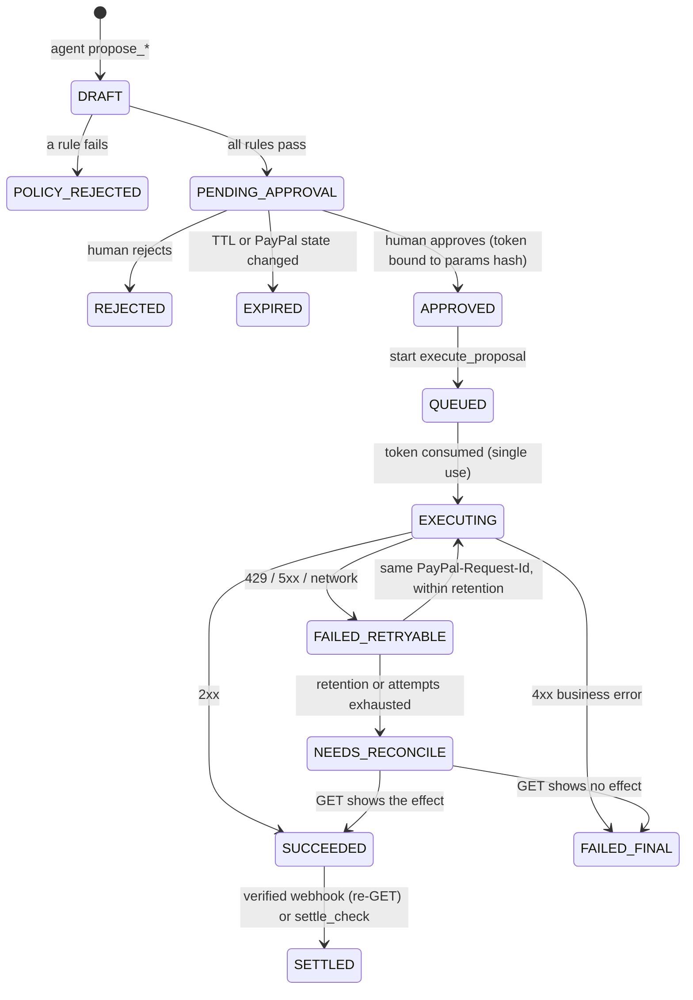

# Architecture (trimmed)

The full design is in `../HACKATHON_ARCHITECTURE_PLAN.md` (outside the repo); this is the part that matches the code.

## Three trust tiers

| Tier      | Code                                                  | Can                                                                       | Cannot                                                         |
| --------- | ----------------------------------------------------- | ------------------------------------------------------------------------- | -------------------------------------------------------------- |
| 1 Propose | `packages/agent`                                      | read PayPal + books, insert DRAFT proposals with evidence ids             | import policy (token minting), `paypal/actions`, sandbox setup |
| 2 Decide  | `packages/gate`, `packages/policy`, `apps/web` routes | re-read PayPal, run R1–R10, record the one human decision, mint the token | import the LLM SDK or `paypal/actions`                         |
| 3 Execute | `apps/workflows/src/tasks/execute-proposal.ts`        | call `paypal/actions` with a persisted `PayPal-Request-Id`                | import the LLM SDK or the agent                                |

Enforced by `no-restricted-imports` rules in `tooling/eslint/index.js` and proven by `tooling/eslint/test/boundaries.test.js` in CI.

## Proposal lifecycle

## Data flow

1. `detect_exceptions` (cron every 15 min): refresh known authorizations, Transaction Search window → mirrors → detectors → upsert exceptions → start `triage_exception` for new ones.
2. `triage_exception`: Claude (`claude-opus-5-5`) proposes DRAFTs → gate evaluates each → exception `AWAITING_APPROVAL` or `ESCALATED`.
3. `POST /api/proposals/:id/approve`: gate re-runs policy on fresh state → approval + token → `execute_proposal`.
4. `execute_proposal`: verify token and params hash → consume → persist request id → PayPal → record status, `debug_id`.
5. `POST /api/webhooks/paypal`: store raw bytes → verify (postback, then self-verification) → `process_webhook` re-GETs the resource → `SETTLED`, exception `RESOLVED`.

Every status change writes an audit row in the same transaction; rows are hash-chained and the table rejects UPDATE/DELETE.

## Live and Replay

`packages/replay` wraps `fetch` for both the PayPal client and the Anthropic SDK. Live calls can be recorded (secrets scrubbed); Replay serves them by request hash (database row ids are normalised) and fails loudly on a miss. The web app picks the mode per judge (cookie) and falls back to Replay if Live can't start.
